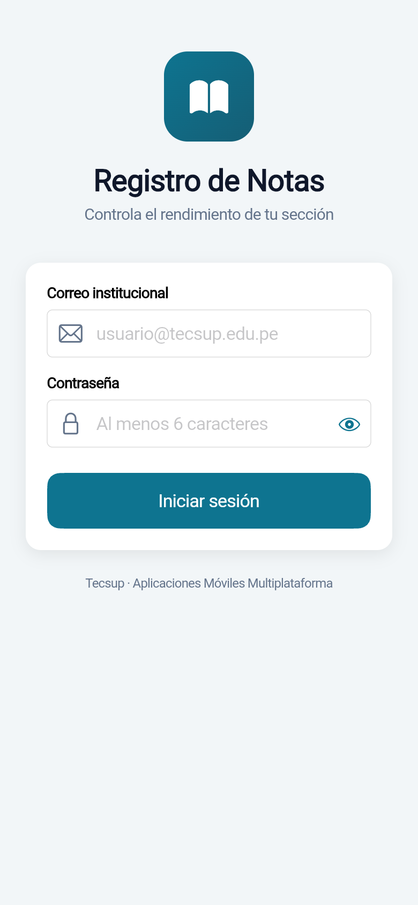
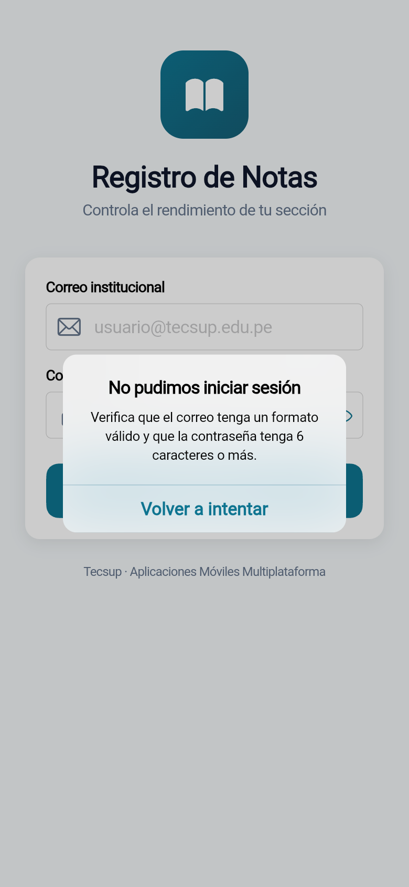
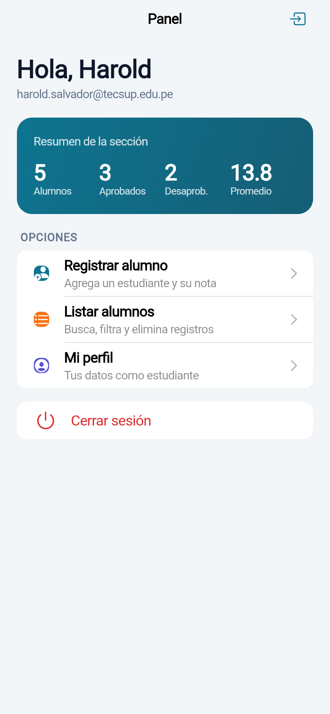
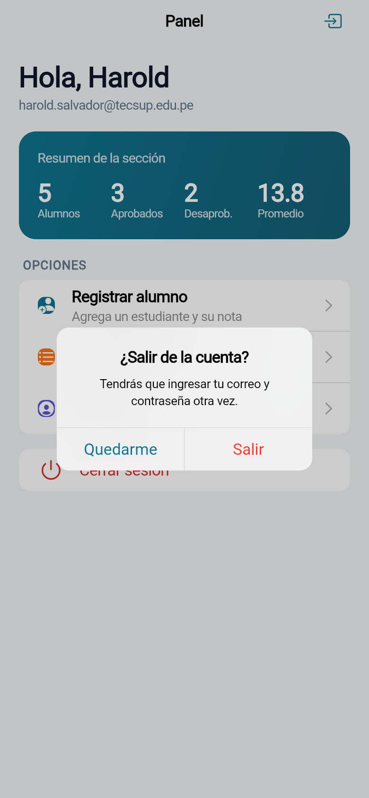
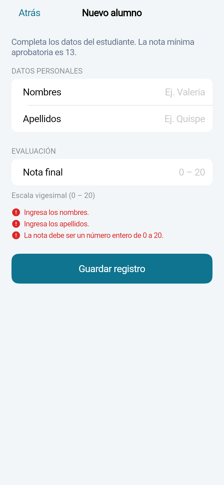
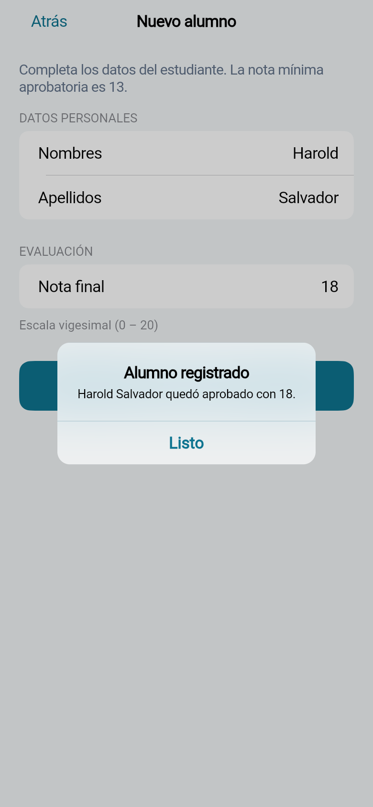
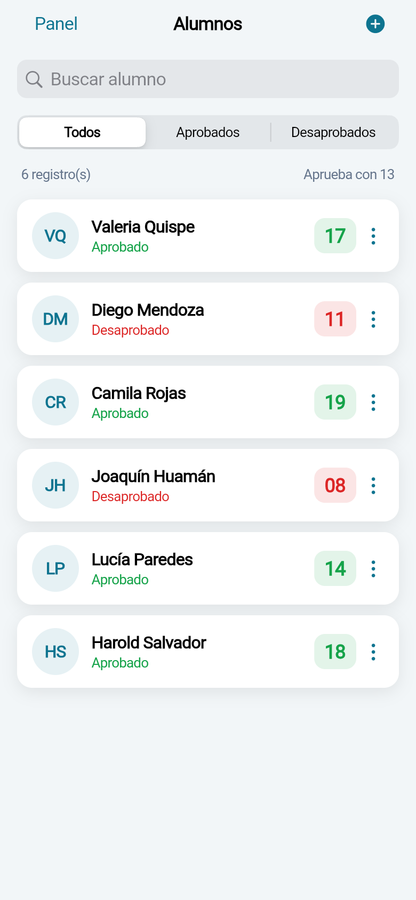
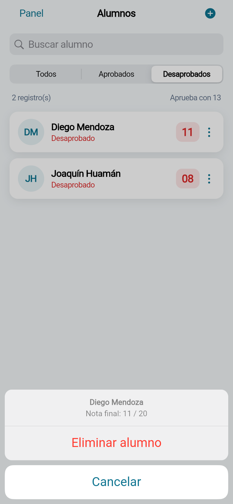

# Laboratorio 11 y 12: Gestión de alumnos con Cupertino

**Alumno:** Harold Salvador Zarate
**Curso:** Aplicaciones Móviles Multiplataforma, Tecsup 2026-II

App en Flutter hecha solo con widgets **Cupertino** (estilo iOS) para gestionar las notas de una sección.

## Funcionalidades
- Inicio de sesión con validación de correo y contraseña (`CupertinoAlertDialog`)
- Panel con resumen de la sección (alumnos, aprobados, desaprobados y promedio)
- Cierre de sesión con alerta de confirmación
- Registro de alumno con validación (nota de 0 a 20; aprueba con 13)
- Listado con búsqueda (`CupertinoSearchTextField`), filtro (`CupertinoSlidingSegmentedControl`) y opciones (`CupertinoActionSheet`)
- Perfil del estudiante

## Estructura
```
lib/
├── main.dart
├── theme.dart
├── models/alumno.dart
└── screens/
    ├── login_screen.dart
    ├── home_screen.dart
    ├── lista_alumnos_screen.dart
    ├── registro_alumno_screen.dart
    └── perfil_screen.dart
```

## Ejecutar
```bash
flutter pub get
flutter run -d chrome
```

## Capturas
| Login | Validación | Panel | Cerrar sesión |
|---|---|---|---|
|  |  |  |  |

| Registro | Registro exitoso | Listado | Hoja de acciones |
|---|---|---|---|
|  |  |  |  |
